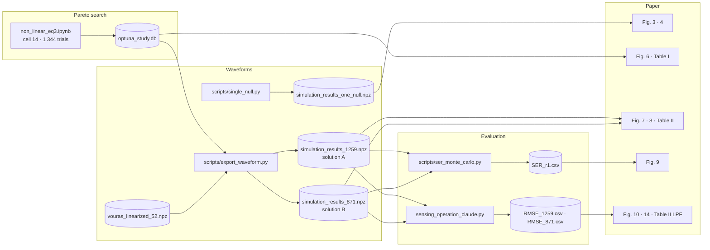

<div align="center">

# Beyond First-Order Spectral Nulling
### Phase-Optimized Waveform Design for Integrated Sensing and Communication (ISAC)

**Ori Nikcha · Harel Naveh · Amir Weiss**<br>
The Alexander Kofkin Faculty of Engineering, Bar-Ilan University, Ramat Gan, Israel

*Code and data for the paper submitted to* **IEEE Transactions on Aerospace and Electronic Systems**


</div>

---

## In one paragraph

We carve **52 spectral nulls** into a constant-envelope LFM radar chirp and transmit OFDM data inside them.
Earlier methods (Gerlach; Vouras, Asilomar 2024) solve this with a **first-order linearization** of the non-convex
phase problem. We solve the **exact** problem instead: the phase perturbation φ is treated as the trainable weights
of a one-layer "network", the loss is a weighted sum of null depth, PSLR, ISLR, smoothness, norm, and null-width terms,
and φ is optimized with automatic differentiation + Adam. Sweeping the loss weights with NSGA-II maps a Pareto front
that **strictly dominates** the linearized solution.

| Result | Linearized baseline [Vouras] | **Proposed** |
|---|---|---|
| Single-null depth | −39.8 dB | **−73.8 dB** |
| SER at 14 dB SNR, 52 nulls (r = 1) | 1.37 × 10⁻² (error floor) | **5.73 × 10⁻⁷** (solution A) |
| PSLR / ISLR, 52 nulls | −20.47 dB / −0.15 dB | **−39.64 dB / −20.21 dB** (solution B) |

<p align="center">
  
  &nbsp;
  
</p>
<p align="center"><sub>Left: 52 nulls between 0.57 and 1.43 MHz. The linearized solution loses the chirp's spectral shape; the optimized waveforms keep it.
Right: the linearized solution hits an interference floor, while solution A tracks the theoretical QPSK bound.
Both plots are produced by the commands in <a href="#4-reproduce-the-paper">§4</a>.</sub></p>

---

## Contents
1. [How the method works](#1-how-the-method-works)
2. [Repository map](#2-repository-map)
3. [Installation](#3-installation)
4. [Reproduce the paper](#4-reproduce-the-paper)
5. [Pipeline: which script feeds which](#5-pipeline-which-script-feeds-which)
6. [Paper figure / table → code map](#6-paper-figure--table--code-map)
7. [Stage details](#7-stage-details)
8. [Simulation parameters](#8-simulation-parameters)
9. [Data artifacts](#9-data-artifacts)
10. [Reproducibility guarantees](#10-reproducibility-guarantees)
11. [Citation](#11-citation)

---

## 1. How the method works

<div align="center">

</div>

1. **Input:** an LFM chirp `s(t) = exp(jπ(B/T)t²)`, sampled at `fs = 10 MHz` → `N = 600` samples.
2. **Initial phase:** `φ = 0` (the plain chirp) for the 52-null Pareto search; the linearized Vouras/Gerlach phase (`version1.getphi()`, Appendix A) for the single-null experiment.
3. **Forward pass:** `x_s = s · e^{jφ}` (constant envelope is preserved by construction).
4. **Loss** (paper Eq. 10). Each term is divided by its value at the linearized (Vouras) phase, so every term starts on the same scale:

   ```
   L = β_nulls Σ|X_s(f_k)|²  +  β_norm‖φ‖²  +  β_smooth‖Dφ‖²
     + β_PSLR γ²_PSLR  +  β_ISLR γ²_ISLR  +  β_deriv1 L_deriv1  +  β_deriv2 L_deriv2
   ```
5. **Backward pass:** PyTorch autograd → Adam step on φ, 5 000 iterations. The φ with the lowest total loss is kept.
6. **Pareto search:** Optuna NSGA-II (population 50, **1 344 trials**) samples `β ∈ [10⁻², 10²]` and `lr ∈ [10⁻⁴, 10⁻¹]` (log-uniform) and minimizes (null energy, PSLR, ISLR).
7. **Selected solutions:** trial **#1259 → solution A** (communication-oriented) and trial **#871 → solution B** (sensing-oriented).

<div align="center">

</div>

The transmitted ISAC signal is `x(t) = √(1/(1+r²)) x_c(t) + √(r²/(1+r²)) x_s(t)`, where `x_c` is a 64-subcarrier OFDM symbol
(48 QPSK data + 4 pilots + DC + 11 guards). Communication is scored by **SER**, sensing by **delay RMSE**, PSLR/ISLR and the **ambiguity function**.

---

## 2. Repository map

| File | Role | Paper section |
|---|---|---|
| **Core library** | | |
| `helper_functions.py` | Basis matrix `z`, inner products, spectrum, matched filter | II, App. A |
| `version1.py` | **Linearized baseline** (`getphi`): closed-form minimum-norm phase | App. A |
| `OFDM_2.py` | OFDM modulator/demodulator, subcarrier frequencies, QPSK (Gray) mapper | IV-C |
| `null_depth_control.py`, `null_width_control.py` | Linearized method with depth control (CG) and derivative constraints | App. A, B |
| **Optimization** | | |
| `non_linear_eq3.ipynb` | Development notebook: optimizer, Optuna study (cell 14), Pareto plots (cells 17, 26) | III, IV-D |
| `optuna_study.db` | The Optuna study: all 1 344 completed trials (parameters + objectives) | IV-D, Table I |
| `scripts/export_waveform.py` | **Re-runs one trial exactly and writes its waveform** (`simulation_results_<trial>.npz`) | IV-D |
| `scripts/single_null.py` | Single-null experiment → `simulation_results_one_null.npz` | IV-B |
| `vouras_linearized_52.npz` | The linearized (Vouras) waveform for 52 nulls, stored once (see §10) | App. A |
| **Evaluation** | | |
| `scripts/ser_monte_carlo.py` | Communication Monte Carlo (AWGN, OFDM receiver) → `SER_r1.csv` | IV-F |
| `sensing_operation_claude.py` | Sensing: receiver LPF, PSLR/ISLR, **RMSE vs SNR** + CRLB, ROC, **ambiguity function** | IV-E, G, H, I |
| `ofdm_creation.ipynb` | Original (slow, loop-based) SER notebook — same model as `scripts/ser_monte_carlo.py` | IV-F |
| **Figures** | | |
| `figures_making_one_null.py` | Fig. 3, 4 | IV-B |
| `scripts/make_pareto_figure.py` | Fig. 6 + prints Table I | IV-D |
| `scripts/make_52null_figures.py` | Fig. 7, 8 + prints Table II (no-filter columns) | IV-E |
| `scripts/make_ser_figure.py` | Fig. 9 | IV-F |
| `scripts/make_rmse_figure.py` | Fig. 10 | IV-G |

---

## 3. Installation

```bash
git clone https://github.com/OriNik100/Spec_Null.git
cd Spec_Null
python -m venv .venv && source .venv/bin/activate      # Windows: .venv\Scripts\activate
pip install -r requirements.txt
```
`requirements.txt`: `numpy>=2.0`, `scipy`, `matplotlib`, `torch` (CPU build is enough), `optuna`, `scikit-learn`, `pandas`, `plotly`, `nbformat`, `jupyter`.
*Developed with Python 3.9/3.12; the full pipeline was re-run on Python 3.13, NumPy 2.5, PyTorch 2.15, Optuna 5.1. No GPU is needed.*

---

## 4. Reproduce the paper

<div align="center">

</div>

Run from the repository root. Times are for one CPU core.

| # | Command | Produces | Time |
|---|---|---|---|
| 1 | `python scripts/export_waveform.py --trial 1259` | `simulation_results_1259.npz` (solution A); prints **PASS** if identical to the Optuna trial | 70 s |
| 2 | `python scripts/export_waveform.py --trial 871` | `simulation_results_871.npz` (solution B) | 70 s |
| 3 | `python scripts/single_null.py` | `simulation_results_one_null.npz` | 2 min |
| 4 | `python scripts/ser_monte_carlo.py` | `SER_r1.csv` (A, B, linearized; 3·10³–4·10⁵ frames per point) | 2 min |
| 5 | `python scripts/make_pareto_figure.py` | Fig. 6, Table I | 5 s |
| 6 | `python scripts/make_52null_figures.py` | Fig. 7, Fig. 8, Table II (no filter) | 5 s |
| 7 | `python scripts/make_ser_figure.py` | Fig. 9 | 2 s |
| 8 | `python figures_making_one_null.py` | Fig. 3, Fig. 4 | 5 s |
| 9 | `python sensing_operation_claude.py` (once with `FILENAME = 'simulation_results_1259.npz'`, once with `…_871.npz`) | Table II (LPF columns), Fig. 14 (a)–(c) for B, RMSE CSV per waveform | 4.4 h each* |
| 10 | `python scripts/make_rmse_figure.py --a RMSE_1259.csv --b RMSE_871.csv` | Fig. 10 | 2 s |

<sub>*10⁶ trials × 100 SNR points × 3 waveforms. Set `N_TRIALS_SWEEP = 2000` for a 1-minute check; the PSLR/ISLR/ambiguity outputs do not depend on it. Set `RMSE_CSV_FILENAME` to `RMSE_1259.csv` / `RMSE_871.csv` to match step 10.</sub>

Steps 1–8 reproduce Tables I–II and Figs. 3, 4, 6–9 in **under 10 minutes**, from nothing but the code and `optuna_study.db`.
The only longer job is re-running the Pareto search itself (§7, ≈ 30 CPU-hours) — its result is the committed `optuna_study.db`, and step 1–2 prove that any trial in it can be regenerated exactly.

---

## 5. Pipeline: which script feeds which

<div align="center">

</div>

<details open>
<summary><b>Text version (renders natively on GitHub)</b></summary>


</details>

---

## 6. Paper figure / table → code map

| Paper item | Content | Produced by | Input |
|---|---|---|---|
| Fig. 1, 2, 5 | Concept / block diagrams | drawn by hand | — |
| Fig. 3, 4 | Single null: PSD, matched filter | `figures_making_one_null.py` | `simulation_results_one_null.npz` |
| Fig. 6 | 3-D Pareto front + projections | `scripts/make_pareto_figure.py` (or notebook cells 17 + 26) | `optuna_study.db` |
| Table I | β weights of A (#1259), B (#871) | `scripts/make_pareto_figure.py` (printed) | `optuna_study.db` |
| Fig. 7, 8 | PSD and matched filter, 52 nulls | `scripts/make_52null_figures.py` | `simulation_results_{1259,871}.npz` |
| Table II, no filter | PSLR, ISLR | `scripts/make_52null_figures.py` (printed) | same |
| Table II, with LPF | PSLR, ISLR after `[0, B]` filter | `sensing_operation_claude.py` → "Diagnostics AFTER filtering" | same |
| Fig. 9 | SER vs SNR | `scripts/ser_monte_carlo.py` → `scripts/make_ser_figure.py` | same |
| Fig. 10 | Delay RMSE vs SNR | `sensing_operation_claude.py` → `scripts/make_rmse_figure.py` | same |
| Fig. 14 (a)–(c) | Ambiguity functions | `sensing_operation_claude.py` → `ambiguity_*.png` | `simulation_results_871.npz` |
| §IV-G | RMS (Gabor) bandwidth | `sensing_operation_claude.py` → "RMS bandwidth" | same |
| Opt. C, Fig. 11–13, 14(d) | LPF-aware solution | *to be added* | — |

---

## 7. Stage details

<details>
<summary><b>Pareto search (re-running the study, ≈ 30 CPU-hours)</b></summary>

`non_linear_eq3.ipynb`: run cells 0 (set-up), 3 (`calculate_mf_pslr_islr_torch`), then 14 (`# Bullet Proof`) with
```python
study = optuna.create_study(directions=["minimize"] * 3,
                            sampler=optuna.samplers.NSGAIISampler(population_size=50),
                            storage="sqlite:///optuna_study.db", study_name="spectral_nulling", load_if_exists=True)
study.optimize(objective, n_trials=1344)
```
Each trial starts from `φ = 0`, runs 5 000 Adam iterations and returns (null energy [dB], PSLR [dB], ISLR [dB]).
NSGA-II's random sampling is not seeded, so a new study visits different β vectors. Every *individual* trial, however, is reproduced exactly from its stored parameters by `scripts/export_waveform.py`.
</details>

<details>
<summary><b>Exporting a waveform</b></summary>

```bash
python scripts/export_waveform.py --trial 1259
```
Reads the trial's `lr` and β from `optuna_study.db` and repeats the trial's computation with the same operation order. It compares the three objectives with the database (default tolerance 10⁻⁵ dB) and writes
`time, s_nulled, Fs, freqs, S_orig_norm, T, s_lin` (same keys as the notebook), plus `phi, trial, objectives_db, param_names, param_values`.
Any point of the Pareto front can be exported this way (`--trial <number>`).
</details>

<details>
<summary><b>Single null</b></summary>

Null at the 2¹⁴-FFT bin nearest 0.4 MHz. Start from the linearized phase, all β = 1, Adam lr = 0.01, 50 000 iterations.
Expected output: null depth −39.80 dB (linearized) → **−73.77 dB** (proposed); PSLR −13.32 → −13.69 dB; ISLR −9.33 → −9.75 dB.
</details>

<details>
<summary><b>Communication Monte Carlo</b></summary>

`scripts/ser_monte_carlo.py` uses the same signal model and receiver as `ofdm_creation.ipynb` (verified identical to 10⁻¹⁵), but processes frames as matrices and gives every (waveform, SNR) point its own seed.
Frames per point: 3·10³ (SNR < 10 dB), 5·10³ (10 dB), 4·10⁵ (> 10 dB) for the proposed waveforms; 5·10³ from 10 dB upward for the linearized waveform.
The theoretical curve is the QPSK SER over AWGN, `2Q(√γ) − Q²(√γ)`.
</details>

<details>
<summary><b>Sensing evaluation</b></summary>

Constants at the top of `sensing_operation_claude.py`: `FILENAME`, `TRUE_DISTANCE_M = 1500.15`, `SNR_SWEEP_DB = np.arange(-18, -4, 0.14)` (100 points), `N_TRIALS_SWEEP = 1_000_000`, `SEED = 42`.
All signals are filtered to `[0, B]` and renormalized to unit power. Delay is the matched-filter peak with parabolic interpolation, and the CRLB uses the RMS bandwidth.
The SNR is per sample (`noise power = signal power · 10^(−SNR/10)`).
</details>

---

## 8. Simulation parameters

| Symbol | Value | Where in code |
|---|---|---|
| Chirp bandwidth `B` | 2 MHz (sweep 0 → B) | `B = 2e6` |
| Pulse / OFDM symbol duration `T` | 60 µs | `T = 60e-6` |
| Sampling rate `fs` | 10 MHz (= 5B) → `N = 600` samples | `Fs = 5 * B` |
| Spectral analysis size | 2¹⁴ | `N_fft = 2**14` |
| OFDM | 64-pt, centre 1 MHz, spacing `1/T = 16.67 kHz` | `OFDM_2.OFDM` |
| Nulls | 52 active subcarriers = 48 data (QPSK, Gray) + 4 pilots (±7, ±21) | `OFDM_freqs(64, only_active=True)` |
| DC + guards | 1 + 11 (6 lower, 5 upper), not nulled | `guard_num = 11` |
| Sensing-to-communication ratio `r` | 1 | `--r 1` |
| Adam | 5 000 iterations from `φ = 0`; best-loss φ kept | `scripts/export_waveform.py` |
| NSGA-II | population 50, 1 344 trials | `optuna_study.db` |
| Search ranges | `β_i ∈ [10⁻², 10²]`, `lr ∈ [10⁻⁴, 10⁻¹]`, log-uniform | `optuna_study.db` |
| Loss normalization | each term ÷ its value at the linearized phase | `NORM` in `scripts/export_waveform.py` |
| PSLR / ISLR | mainlobe = peak ± 1/B (±5 samples), trapezoidal energies | `calculate_mf_pslr_islr_torch` |
| Receiver LPF | ideal `[0, B]` (FFT mask); the mainlobe is widened to the first nulls after filtering | `bandpass_filter` |

---

## 9. Data artifacts

| File | Content | Written by |
|---|---|---|
| `optuna_study.db` | SQLite Optuna study: 1 344 complete trials (+3 interrupted) | notebook cell 14 |
| `vouras_linearized_52.npz` | Linearized waveform `s_lin` and phase `phi0` for 52 nulls | `version1.getphi` (stored once) |
| `simulation_results_1259.npz` | Solution A: `s_nulled`, `phi`, objectives, β, plus `s_lin` | `scripts/export_waveform.py` |
| `simulation_results_871.npz` | Solution B, same keys | `scripts/export_waveform.py` |
| `simulation_results_one_null.npz` | Single-null proposed + linearized waveforms | `scripts/single_null.py` |
| `SER_r1.csv` | SER per waveform and SNR, with frames, errors and theory | `scripts/ser_monte_carlo.py` |
| `RMSE_1259.csv`, `RMSE_871.csv` | RMSE vs SNR for chirp, linearized and the proposed waveform | `sensing_operation_claude.py` |

All proposed waveforms are unit-modulus, so constant envelope can be checked directly:
`np.allclose(abs(np.load("simulation_results_1259.npz")["s_nulled"]), 1)`.

---

## 10. Reproducibility guarantees

* **Optimization is bit-reproducible.** Every Optuna trial starts from `φ = 0` and is deterministic. `scripts/export_waveform.py` reproduces the stored objectives of trials #1259 and #871 to 2·10⁻¹¹ dB and 2·10⁻⁷ dB on a different OS and PyTorch version, and two runs give identical files.
* **Monte Carlo is seeded.** `scripts/ser_monte_carlo.py` seeds each (waveform, SNR) point independently, so two runs are byte-identical. `sensing_operation_claude.py` uses `np.random.default_rng(42)`.
* **Why the linearized waveform is stored.** For 52 nulls the linearized phase reaches ~10⁴ rad, and the 104 × 104 Gram matrix inverted in `getphi()` has condition number ≈ 3·10¹³. Different BLAS/LAPACK builds therefore produce slightly different baselines (relative 10⁻⁶; null energy 45.86 dB either way). `vouras_linearized_52.npz` fixes the one used in the paper. The single-null case is a well-conditioned 2 × 2 system and is computed on the fly.
* **Precision:** all optimization runs in `float64`.

---

## 11. Citation

```bibtex
@article{nikcha2026beyond,
  title   = {Beyond First-Order Spectral Nulling: Phase-Optimized Waveform Design for Integrated Sensing and Communication},
  author  = {Nikcha, Ori and Naveh, Harel and Weiss, Amir},
  journal = {IEEE Transactions on Aerospace and Electronic Systems},
  note    = {submitted},
  year    = {2026}
}
```

**Baseline reproduced in this repository:** P. Vouras, "Frequency modulated waveforms for integrated imaging and communications," *58th Asilomar Conf. Signals, Systems, and Computers*, 2024, pp. 894–897.

**Contact:** Ori Nikcha · Harel Naveh — Bar-Ilan University. Supervisor: Dr. Amir Weiss.
