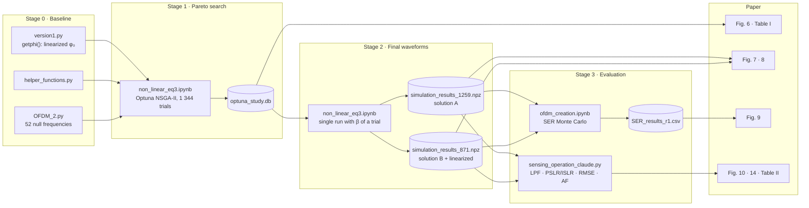

<div align="center">

# Beyond First-Order Spectral Nulling
### Phase-Optimized Waveform Design for Integrated Sensing and Communication (ISAC)

**Ori Nikcha · Harel Naveh · Amir Weiss**<br>
The Alexander Kofkin Faculty of Engineering, Bar-Ilan University, Ramat Gan, Israel

*Code and data for the paper submitted to* **IEEE Transactions on Aerospace and Electronic Systems**


</div>

---

## In one paragraph

We carve **52 spectral nulls** into a constant-envelope LFM radar chirp and transmit OFDM data inside them.
Earlier methods (Gerlach; Vouras, Asilomar 2024) solve this with a **first-order linearization** of the non-convex
phase problem. We solve the **exact** problem instead: the phase perturbation φ is treated as the trainable weights
of a one-layer "network", the loss is a weighted sum of null depth, PSLR, ISLR, smoothness, norm, and null-width terms,
and φ is optimized with automatic differentiation + Adam. Sweeping the loss weights with NSGA-II maps a Pareto front
that **strictly dominates** the linearized solution.

| Result (paper) | Linearized baseline [Vouras] | **Proposed** |
|---|---|---|
| Single-null depth | −40 dB | **−73.2 dB** |
| SER at 14 dB SNR, 52 nulls (r = 1) | 1.33 × 10⁻² (error floor) | **7.29 × 10⁻⁷** (solution A) |
| PSLR / ISLR, 52 nulls | −20.47 dB / −0.15 dB | **−40.32 dB / −19.97 dB** (solution B) |
| PSLR / ISLR after receiver LPF | −12.16 dB / 0.68 dB | **−21.18 dB / −17.59 dB** (solution C, LPF-aware) |

<p align="center">
  
  &nbsp;
  
</p>
<p align="center"><sub>Left: 52 nulls between 0.57 and 1.43 MHz. At the subcarrier frequencies, solution A's nulls sit between −62 and −85 dB (median −69 dB) below the spectral peak, while the linearized solution loses the chirp's spectral shape.
Right: the linearized solution hits an interference floor, while solution A tracks the theoretical QPSK bound.
Both plots are regenerated from the committed data by <code>scripts/</code>.</sub></p>

---

## Contents
1. [How the method works](#1-how-the-method-works)
2. [Repository map](#2-repository-map)
3. [Installation](#3-installation)
4. [Reproduce the paper — three levels](#4-reproduce-the-paper--three-levels)
5. [Pipeline: which script feeds which](#5-pipeline-which-script-feeds-which)
6. [Paper figure / table → code map](#6-paper-figure--table--code-map)
7. [Step-by-step instructions](#7-step-by-step-instructions)
8. [Simulation parameters](#8-simulation-parameters)
9. [Data artifacts](#9-data-artifacts)
10. [Reproducibility notes](#10-reproducibility-notes)
11. [Citation](#11-citation)

---

## 1. How the method works

<div align="center">

</div>

1. **Input:** an LFM chirp `s(t) = exp(jπ(B/T)t²)`, sampled at `fs = 10 MHz` → `N = 600` samples.
2. **Initial condition:** the linearized minimum-norm phase `φ₀` of Vouras/Gerlach (Appendix A), computed in closed form by `version1.getphi()`.
3. **Forward pass:** `x_s = s · e^{jφ}` (constant envelope is preserved by construction).
4. **Loss** (paper Eq. 10). Each term is normalized by its value at `φ₀`:

   ```
   L = β_nulls Σ|X_s(f_k)|²  +  β_norm‖φ‖²  +  β_smooth‖Dφ‖²
     + β_PSLR γ²_PSLR  +  β_ISLR γ²_ISLR  +  β_deriv1 L_deriv1  +  β_deriv2 L_deriv2
   ```
5. **Backward pass:** PyTorch autograd → Adam step on φ. The best-loss φ over 5 000 iterations is kept.
6. **Pareto search:** Optuna NSGA-II (population 50, **1 344 trials**) samples `β ∈ [10⁻², 10²]` and `lr ∈ [10⁻⁴, 10⁻¹]` (log-uniform) and minimizes (null energy, PSLR, ISLR).
7. **Selected solutions:** trial **#1259 → solution A** (communication-oriented) and trial **#871 → solution B** (sensing-oriented). These trial numbers appear in the file names `simulation_results_1259.npz` and `simulation_results_871.npz`.

<div align="center">

</div>

The transmitted ISAC signal is `x(t) = √(1/(1+r²)) x_c(t) + √(r²/(1+r²)) x_s(t)`, where `x_c` is a 64-subcarrier OFDM symbol
(48 QPSK data + 4 pilots + DC + 11 guards). Communication is scored by **SER** and sensing by **delay RMSE**, PSLR/ISLR and the **ambiguity function**.

---

## 2. Repository map

| File | Role | Paper section |
|---|---|---|
| **Core library** | | |
| `helper_functions.py` | Basis matrix `z`, inner products, spectrum, matched filter | II, App. A |
| `version1.py` | **Linearized baseline** (`getphi`): closed-form minimum-norm phase | App. A |
| `OFDM_2.py` | OFDM modulator/demodulator, subcarrier frequencies, QPSK (Gray) mapper | IV-C |
| `null_depth_control.py` | Conjugate-gradient depth/smoothness trade-off of the linearized method | App. A |
| `null_width_control.py` | Linearized solution with 1st/2nd-derivative (null-width) constraints | III-C, App. B |
| **Optimization (Stage 1–2)** | | |
| `non_linear_eq3.ipynb` | **Proposed optimizer** (PyTorch + Adam), Optuna NSGA-II Pareto search, waveform export | III, IV-B, IV-D |
| `optuna_study.db` | Optuna study: all 1 344 completed trials (parameters + objectives) | IV-D, Table I |
| **Evaluation (Stage 3)** | | |
| `ofdm_creation.ipynb` | Communication Monte Carlo: AWGN channel, OFDM receiver, **SER** | IV-F |
| `sensing_operation_claude.py` | Sensing evaluation: receiver LPF, PSLR/ISLR, **RMSE vs SNR** + CRLB, ROC, **ambiguity function** | IV-E, IV-G, IV-H, IV-I |
| **Figures** | | |
| `scripts/make_pareto_figure.py` | Fig. 6 (Pareto front) + prints Table I from `optuna_study.db` | IV-D |
| `scripts/make_52null_figures.py` | Fig. 7 (PSD), Fig. 8 (matched filter), Table II no-filter columns | IV-E |
| `scripts/make_ser_figure.py` | Fig. 9 (SER) from `SER_results_r1.csv` | IV-F |
| `figures_making_one_null.py` | Fig. 3–4 (single-null PSD and matched filter) | IV-B |
| `SER_and_RMSE_figures.py` | Fig. 9 / Fig. 10 in IEEE style | IV-F, IV-G |
| **Stored results** | see [§9 Data artifacts](#9-data-artifacts) | |
| **Exploratory (not in the paper)** | `non_linear_perf.py`, `optimal_phasor*.npy`, `sensing_operation.py`, `PSLR_ISLR_ISAC.py` | — |

---

## 3. Installation

```bash
git clone https://github.com/OriNik100/Spec_Null.git
cd Spec_Null
python -m venv .venv && source .venv/bin/activate      # Windows: .venv\Scripts\activate
pip install -r requirements.txt
```

`requirements.txt`:
```
numpy>=2.0        # np.trapezoid requires NumPy 2.x
scipy
matplotlib
torch             # CPU build is sufficient
optuna
scikit-learn      # ROC curves in the sensing evaluation
pandas
plotly
nbformat
jupyter
```

*Developed with Python 3.9/3.12. The evaluation pipeline was also re-run on Python 3.13, NumPy 2.5, PyTorch 2.15 and Optuna 5.1. No GPU is needed.*

---

## 4. Reproduce the paper — three levels

<div align="center">

</div>

| Level | What you reproduce | Starting point | CPU time* |
|---|---|---|---|
| **1 — Verify** | Table I, Table II, Fig. 6, 7, 8, 9, 14 | Stored waveforms + `optuna_study.db` + SER CSV | **≈ 2 min** |
| **2 — Re-simulate** | SER curves (Fig. 9) and RMSE curves (Fig. 10) from scratch | Stored waveforms | SER ≈ 45 min per waveform · RMSE ≈ 4.4 h |
| **3 — Re-optimize** | The Pareto search and the waveforms themselves | Nothing but the code | ≈ 1.5–2 min per trial → ≈ 35–45 h for 1 344 trials |

<sub>*Measured on one modern x86 CPU core. SER: 3.3 ms per OFDM frame × 8.2·10⁵ frames. RMSE: 52 µs per trial × 10⁶ trials × 100 SNR points × 3 waveforms.</sub>

### Level 1 in four commands
```bash
python scripts/make_pareto_figure.py      # Fig. 6 + prints Table I
python scripts/make_52null_figures.py     # Fig. 7, Fig. 8 + prints Table II (no-filter columns)
python scripts/make_ser_figure.py         # Fig. 9 (from stored Monte-Carlo results)
python sensing_operation_claude.py        # prints Table II (LPF columns) + Fig. 14 (a)–(c) + RMSE
```
For a fast Level-1 run of `sensing_operation_claude.py`, first set `N_TRIALS_SWEEP = 2000` at the top of the file.
The PSLR/ISLR values it prints do not depend on the number of Monte-Carlo trials.
`FILENAME` selects the waveform. The default `simulation_results_1259.npz` gives the Table II row for A. Set `simulation_results_871.npz` for row B and for Fig. 14 (a)–(c).

---

## 5. Pipeline: which script feeds which

<div align="center">

</div>

<details open>
<summary><b>Text version (renders natively on GitHub)</b></summary>


</details>

---

## 6. Paper figure / table → code map

| Paper item | Content | Produced by | Input |
|---|---|---|---|
| Fig. 1, 2, 5 | Concept / block diagrams | drawn by hand | — |
| Fig. 3, 4 | Single null: PSD, matched filter | `figures_making_one_null.py` | `simulation_results_one_null.npz` ⚠️ |
| Fig. 6 | 3-D Pareto front + projections | `scripts/make_pareto_figure.py` | `optuna_study.db`, `simulation_results_871.npz` |
| Table I | β weights of solutions A, B | `scripts/make_pareto_figure.py` (printed) | `optuna_study.db` |
| Fig. 7 | PSD of LFM / A / B / linearized | `scripts/make_52null_figures.py` | `simulation_results_{1259,871}.npz` |
| Fig. 8 | Matched-filter close-up | `scripts/make_52null_figures.py` | same |
| Table II, columns 1–2 | PSLR, ISLR (no filter) | `scripts/make_52null_figures.py` (printed) | same |
| Table II, columns 3–4 | PSLR, ISLR after receiver LPF | `sensing_operation_claude.py` → "Diagnostics AFTER filtering" | same |
| Table II, row "Opt. C" | LPF-aware solution | LPF-aware optimizer ⚠️ | ⚠️ |
| Fig. 9 | SER vs SNR, r = 1 | `ofdm_creation.ipynb` (SER cell) → `scripts/make_ser_figure.py` | `simulation_results_{1259,871}.npz` |
| Fig. 10 | Delay RMSE vs SNR | `sensing_operation_claude.py` (run once per waveform) | same |
| Fig. 11–13 | LPF-aware SER, matched filter, RMSE | LPF-aware optimizer ⚠️ | ⚠️ |
| Fig. 14 (a)–(c) | Ambiguity functions (LFM, linearized, B) | `sensing_operation_claude.py` → `ambiguity_*.png` | `simulation_results_871.npz` |
| Fig. 14 (d) | Ambiguity function, LPF-aware C | ⚠️ | ⚠️ |
| Eq. 12, §IV-G | RMS bandwidth `B_rms` | `sensing_operation_claude.py` → "RMS bandwidth (Gabor)" | same |

<!-- AUTHORS: every ⚠️ row must point to a committed script/data file before release. See REPO_REVIEW.md, section A. -->

---

## 7. Step-by-step instructions

<details>
<summary><b>Stage 0 — Linearized baseline (Appendix A)</b></summary>

```python
from OFDM_2 import OFDM_freqs
from version1 import getphi
T = 60e-6
nulls = OFDM_freqs(64, T=T, only_active=True)   # 52 active subcarriers around 1 MHz
phi0 = getphi(nulls)                             # (600, 1) closed-form minimum-norm phase
```
`python version1.py` shows the single-null (0.4 MHz) linearized solution, the CG depth-control sweep (`null_depth_control.py`) and the derivative-constrained wider null (`null_width_control.py`).
</details>

<details>
<summary><b>Stage 1 — Pareto search (Section IV-D) · Level 3</b></summary>

Open `non_linear_eq3.ipynb` and run, in order:

| Cell | First line | Purpose |
|---|---|---|
| 0 | `#1` | System parameters, 52 null frequencies, steering matrix, `z` |
| 1 | `from version1 import getphi` | Initial condition `phi_start` = linearized solution |
| 3 | `def calculate_mf_pslr_islr_torch` | Differentiable PSLR / ISLR |
| 14 | `# Bullet Proof` | Optuna objective (5 000 Adam iterations per trial) and NSGA-II study |

For the paper's study, create it with
```python
study = optuna.create_study(directions=["minimize"] * 3,
                            sampler=optuna.samplers.NSGAIISampler(population_size=50),
                            storage="sqlite:///optuna_study.db", study_name="spectral_nulling",
                            load_if_exists=True)
study.optimize(objective, n_trials=1344)
```
Objectives returned per trial: total null energy [dB], PSLR [dB], ISLR [dB].
</details>

<details>
<summary><b>Stage 2 — Export a chosen Pareto point as a waveform</b></summary>

1. Read the trial's parameters from `optuna_study.db` (e.g. `optuna.load_study(...).trials[1259].params`).
2. Put them into cell 4 (`# 2`) of `non_linear_eq3.ipynb` and run cells 4 → 5 → 6.
3. Cell 6 writes `simulation_results.npz` with keys `s_nulled` (proposed), `s_lin` (linearized), `time`, `Fs`, `T`, `freqs`, `S_orig_norm`. Rename it to `simulation_results_<trial>.npz`.
</details>

<details>
<summary><b>Stage 3a — Communication: SER (Fig. 9) · Level 2</b></summary>

In `ofdm_creation.ipynb`:
1. Cell 2: set the file to `simulation_results_1259.npz` (solution A) or `simulation_results_871.npz` (solution B).
2. Run cells 0 → 6 (setup, OFDM transmitter, AWGN channel, receiver, `SER_Comp`).
3. SER cell (cell 8): set `StC_ratio = [1]`, `csv_filename = 'SER_results_r1.csv'` and enable the linearized (`SER_VOURAS`) lines.
   Monte-Carlo frames per SNR point used for the stored results: 3·10³ (SNR < 10 dB), 5·10³ (10 dB), 4·10⁵ (> 10 dB) for the proposed waveforms. The linearized curve uses 5·10³ from 10 dB upward.
4. `python scripts/make_ser_figure.py` → `fig9_ser.png`.

The theoretical curve is the QPSK SER over AWGN, `2Q(√γ) − Q²(√γ)`.
</details>

<details>
<summary><b>Stage 3b — Sensing: Table II (LPF), RMSE (Fig. 10), ambiguity function (Fig. 14) · Level 1–2</b></summary>

```bash
python sensing_operation_claude.py
```
Settings at the top of the file:

| Constant | Paper value | Meaning |
|---|---|---|
| `FILENAME` | `simulation_results_1259.npz` / `simulation_results_871.npz` | waveform under test (run once each) |
| `TRUE_DISTANCE_M` | 1500.15 | point-target range [m] |
| `SNR_SWEEP_DB` | `np.arange(-18, -4, 0.14)` | 100 SNR points |
| `N_TRIALS_SWEEP` | 1 000 000 | Monte-Carlo trials per SNR point |
| `SEED` | 42 | NumPy `default_rng` seed |

Outputs: printed diagnostics before/after the `[0, B]` receiver filter (RMS bandwidth, PSLR, ISLR), the RMSE CSV (append-only), and PNGs
`power_spectrum_*.png`, `roc_*.png`, `correlation_comparison_*.png`, `rmse_vs_snr_*.png`, `ambiguity_{chirp,proposed,vouras}_*.png`.
Delay is estimated from the matched-filter peak with parabolic interpolation. The CRLB uses the RMS (Gabor) bandwidth.
</details>

---

## 8. Simulation parameters

| Symbol | Value | Where in code |
|---|---|---|
| Chirp bandwidth `B` | 2 MHz (sweep 0 → B) | `B = 2e6` |
| Pulse / OFDM symbol duration `T` | 60 µs | `T = 60e-6` |
| Sampling rate `fs` | 10 MHz (= 5B) → `N = 600` samples | `fs = 5 * B` |
| Spectral analysis size | 2¹⁴ | `N_FFT = 2**14` |
| OFDM | 64-pt, centre `f_c = 1 MHz`, spacing `1/T = 16.67 kHz` | `OFDM_2.OFDM` |
| Active subcarriers / nulls | 52 = 48 data (QPSK, Gray) + 4 pilots (±7, ±21) | `OFDM_freqs(64, only_active=True)` |
| DC + guards | 1 + 11 (6 lower, 5 upper) — not nulled | `guard_num = 11` |
| Sensing-to-communication ratio `r` | 1 | `SER_Comp(..., r=1)` |
| Adam | 5 000 iterations, best-loss φ kept | notebook cell 14 |
| NSGA-II | population 50, 1 344 trials | `optuna_study.db` |
| Search ranges | `β_i ∈ [10⁻², 10²]`, `lr ∈ [10⁻⁴, 10⁻¹]`, log-uniform | `optuna_study.db` |
| Loss normalization | each term ÷ its value at the linearized initial phase | `norm_*` constants, cell 14 |
| Receiver LPF | ideal brick-wall `[0, B]` (FFT mask) | `bandpass_filter` |

---

## 9. Data artifacts

| File | Content | Written by | Read by |
|---|---|---|---|
| `optuna_study.db` | SQLite Optuna study, 1 344 complete trials (+3 interrupted) | notebook, Stage 1 | `scripts/make_pareto_figure.py` |
| `simulation_results_1259.npz` | **Solution A** `s_nulled` (600 complex samples), linearized `s_lin`, axes | notebook, Stage 2 | all evaluation scripts |
| `simulation_results_871.npz` | **Solution B** `s_nulled`, linearized `s_lin`, axes | notebook, Stage 2 | all evaluation scripts |
| `SER_results_r1.csv` | SER vs SNR, r = 1. Block 1: run with A (+ linearized + theory); block 2: run with B | `ofdm_creation.ipynb` | `scripts/make_ser_figure.py` |
| `SER_results_r5.csv` | Same for r = 5 (supplementary, not in the paper) | `ofdm_creation.ipynb` | — |

All waveforms are unit-modulus (`|s_nulled| = 1`), so constant envelope can be checked directly:
```python
import numpy as np; d = np.load("simulation_results_1259.npz"); assert np.allclose(abs(d["s_nulled"]), 1)
```

---

## 10. Reproducibility notes

* **Stored waveforms are the reference.** The linearized initial phase for 52 nulls is about 10⁴ rad in size.
  The Gram matrix inverted in `getphi()` has condition number ≈ 3·10¹³, so different BLAS/LAPACK builds give initial phases that differ at the 10⁻⁶ relative level.
  The non-convex Adam trajectory amplifies this, so a re-run of Stage 1–2 on another machine gives a waveform of **comparable quality but not bit-identical**.
  All Stage-3 numbers in the paper are computed from the committed `.npz` files.
* **Monte-Carlo seeds.** Communication: `np.random.seed(42)` (legacy global RNG). Sensing: `np.random.default_rng(42)`.
* **PSLR / ISLR definition.** The mainlobe is `peak ± 1/B` (`±5` samples at `fs = 10 MHz`) with trapezoidal energies.
  The optimizer and Table II (no-filter columns) use this definition.
  The LPF evaluation in `sensing_operation_claude.py` widens the mainlobe to at least the first nulls around the peak, because filtering broadens it. Unfiltered values from the two definitions differ by ≤ 0.1 dB.
* **Single precision is not enough:** all optimization runs in `float64` (`torch.set_default_dtype(torch.float64)`).

---

## 11. Citation

```bibtex
@article{nikcha2026beyond,
  title   = {Beyond First-Order Spectral Nulling: Phase-Optimized Waveform Design for Integrated Sensing and Communication},
  author  = {Nikcha, Ori and Naveh, Harel and Weiss, Amir},
  journal = {IEEE Transactions on Aerospace and Electronic Systems},
  note    = {submitted},
  year    = {2026}
}
```

**Baseline reproduced in this repository:** P. Vouras, "Frequency modulated waveforms for integrated imaging and communications," *58th Asilomar Conf. Signals, Systems, and Computers*, 2024, pp. 894–897.

**Contact:** Ori Nikcha · Harel Naveh — Bar-Ilan University. Supervisor: Dr. Amir Weiss.
